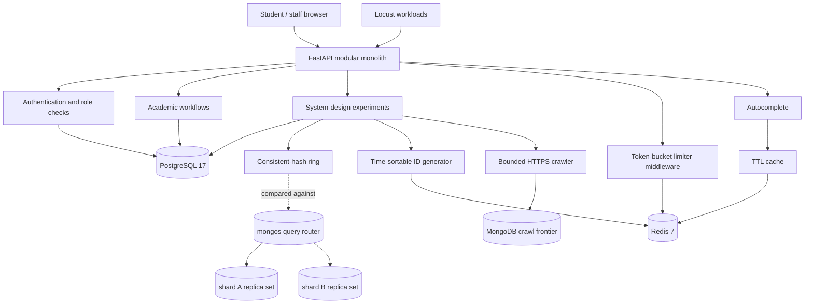

# Architecture and component mapping

## Architecture

PostgreSQL is authoritative for student records, courses, offerings, enrollments, grades,
attendance, timetable entries, notifications, and short-link mappings. The cache is only an
optimization; it is not used to decide whether a seat is available or whether a grade is valid.

Two more state stores are real and required:

- **Redis 7** holds every piece of mutable shared state: the rate-limit token buckets (an atomic
  Lua script, so two processes cannot spend the same token), the autocomplete cache (`SETEX`, with
  `SCAN`-based prefix invalidation), and the ID generator's worker-slot counter.
- **MongoDB 7 sharded cluster**: one `mongos` router, one config-server replica set holding chunk
  metadata, and two shard replica sets. The `sharded_records` collection is sharded on
  `{_id: "hashed"}`, so the record key *is* the shard key and `mongos` owns placement.

The application refuses to start without both. There is no in-memory fallback path: a silent
fallback would hide the exact failure a sharded, multi-process deployment is meant to surface.

## Core domain

- **Student**: identity and profile.
- **Course**: reusable catalog entry.
- **CourseOffering**: a course in a particular term and section, with a capacity and registration status.
- **Enrollment**: a student's lifecycle record for one offering.
- **Assessment / Grade**: assessment maximum marks and each enrolled student's awarded marks.
- **AttendanceRecord**: one attendance state per student, offering, and session date.
- **TimetableEvent**: meeting day/time and room for an offering.
- **AcademicNotification**: student-specific message and read state.

## Enrollment transaction

1. Validate the authenticated student's access and the student/offering identifiers.
2. Check whether the idempotency key already represents this request.
3. Atomically increment `enrolled_count` only if the offering is OPEN and below capacity.
4. Insert the enrollment row in the same database transaction.
5. Commit both changes together; on an insert/constraint failure, roll back the seat increment.
6. Enforce one active enrollment per student/offering with a partial unique index.

The preflight read is not the correctness boundary. The conditional database update and unique index
are the correctness boundary under concurrent requests. Dropping an enrollment changes its status
and decrements the counter in one transaction. A request racing the drop may receive a retryable
HTTP 409 if it reaches the capacity check before the seat release commits.

## Shard ownership: two answers, compared

The app keeps a `ConsistentHashRing` (SHA-256, 100 virtual nodes per shard) because the ring is the
part of the design under study. `mongos` is the authority. `GET /system-design/route/{key}` asks both
and returns both, so a disagreement between the ring's placement and the router's real placement is
visible in the response instead of being silently averaged away. `POST /shards/move-chunk` performs a
real `moveChunk` with explicit bounds, and `POST /shards/rebalance` defers to the balancer.

## Trust boundaries

- Public: health check, course discovery, open-offering discovery, registration, login, autocomplete.
- Authenticated student: own profile, enrollment list, grades, notifications, enrollment/drop.
- Staff/admin: create catalog/offerings, record attendance/grades, manage timetable/notifications,
  create short links, move shards, rebalance, and run the crawler.
- Redis and `mongos` listen on loopback only. They are single-node labs: Redis has no replication and
  the Mongo replica sets have one member each, so neither survives the loss of its host. Shared state
  across app processes is real; high availability is not claimed.
