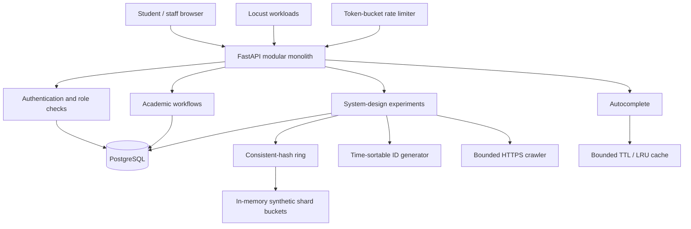

# Architecture and component mapping

## Architecture

PostgreSQL is authoritative for student records, courses, offerings, enrollments, grades,
attendance, timetable entries, notifications, and short-link mappings. The cache is only an
optimization; it is not used to decide whether a seat is available or whether a grade is valid.

## Core domain

- **Student**: identity and profile.
- **Course**: reusable catalog entry.
- **CourseOffering**: a course in a particular term and section, with a capacity and registration status.
- **Enrollment**: a student's lifecycle record for one offering.
- **Assessment / Grade**: assessment maximum marks and each enrolled student's awarded marks.
- **AttendanceRecord**: one attendance state per student, offering, and session date.
- **TimetableEvent**: meeting day/time and room for an offering.
- **AcademicNotification**: student-specific message and read state.

## Enrollment transaction

1. Validate the authenticated student's access and the student/offering identifiers.
2. Check whether the idempotency key already represents this request.
3. Atomically increment `enrolled_count` only if the offering is OPEN and below capacity.
4. Insert the enrollment row in the same database transaction.
5. Commit both changes together; on an insert/constraint failure, roll back the seat increment.
6. Enforce one active enrollment per student/offering with a partial unique index.

The preflight read is not the correctness boundary. The conditional database update and unique index
are the correctness boundary under concurrent requests. Dropping an enrollment changes its status
and decrements the counter in one transaction. A request racing the drop may receive a retryable
HTTP 409 if it reaches the capacity check before the seat release commits.

## Trust boundaries

- Public: health check, course discovery, open-offering discovery, registration, login, autocomplete.
- Authenticated student: own profile, enrollment list, grades, notifications, enrollment/drop.
- Staff/admin: create catalog/offerings, record attendance/grades, manage timetable/notifications,
  create short links, mutate demonstration shard/ring state, and run the crawler.
- The rate limiter, cache, ring, and in-memory shard store are process-local lab components.
  They are not distributed coordination mechanisms and must not be presented as such.
